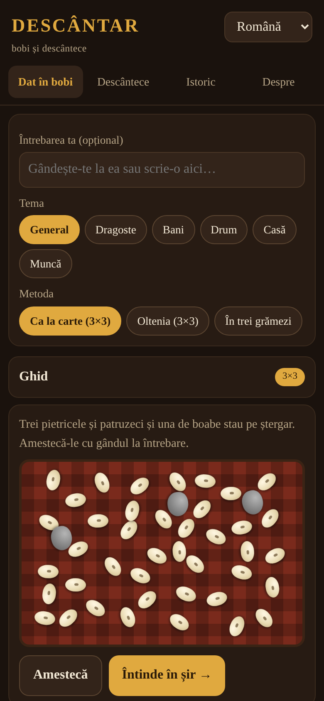

# DESCÂNTAR

[English](README.md) · [Română](README.ro.md) · **Français** · [Italiano](README.it.md) · [Español](README.es.md) · [Português](README.pt.md) · [Deutsch](README.de.md) · [Magyar](README.hu.md)

Divination romaine aux haricots (41 haricots) et incantations traditionnelles, interface en 8 langues, dans un seul fichier hors ligne.

**[Ouvrir l’application →](https://descantar.chiuta.ro/)**

_Version: 1.2.0 · Dernière mise à jour: 2026-11-08_

| 1 | 2 | 3 |
|---|---|---|
|  |  |  |

## Fonctions

- Trois méthodes : « version traditionnelle » 3×3 (par défaut), la variante d’Olténie avec ses signes, et une méthode simple à trois tas.
- Lecture Tête / Cœur / Pieds, signes impair–pair, bilan OUI/NON et résultat copiable ; historique des tirages.
- 12 incantations traditionnelles, phase de la lune, compteur de récitations, générateur et guide copiable.

## Utilisation

Ouvrez la page en ligne, ou téléchargez `index.html` et ouvrez-le dans un navigateur récent. Sans installation ni build.

## Limites

- Divertissement et folklore, pas un conseil ; ne l’utilisez pas pour des décisions médicales, juridiques ou financières.
- Les règles d’Olténie proviennent d’un texte que je n’ai pas pu vérifier ; un vers de l’incantation est obscur et indiqué comme variante locale.
- Interface en 8 langues, mais les lectures, incantations et le guide sont pour l’instant en roumain uniquement.

## Confidentialité

Aucun suivi, aucune requête réseau (CSP `connect-src none`), aucun compte. Les données restent dans ce navigateur (localStorage) et peuvent être effacées à tout moment.

## Licence

MIT — voir [LICENSE](LICENSE).
