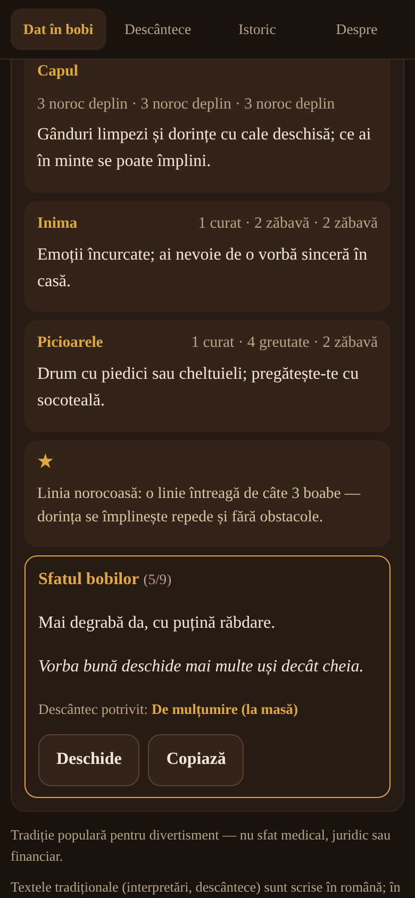

# DESCÂNTAR

[English](README.md) · [Română](README.ro.md) · [Français](README.fr.md) · **Italiano** · [Español](README.es.md) · [Português](README.pt.md) · [Deutsch](README.de.md) · [Magyar](README.hu.md)

Divinazione rumena con i fagioli (41 fagioli) e incantesimi tradizionali, interfaccia in 8 lingue, in un unico file offline.

**[Apri l’app →](https://descantar.chiuta.ro/)**

_Versione: 1.4.2 · Ultimo aggiornamento: 2026-11-17_

| 1 | 2 | 3 |
|---|---|---|
|  |  |  |

## Funzioni

- Tre metodi: «tradizionale» 3×3 (predefinito), la variante dell’Oltenia con i suoi segni e un semplice metodo a tre mucchi.
- Lettura Testa / Cuore / Piedi, segni dispari–pari, bilancio SÌ/NO e risultato copiabile; cronologia delle letture.
- 12 incantesimi tradizionali, fase lunare, contatore di recite, generatore e guida copiabile.

## Utilizzo

Apri la pagina online, oppure scarica `index.html` e aprilo in un browser recente. Nessuna installazione né build.

## Limiti

- Intrattenimento e folklore, non un consiglio; non usarlo per decisioni mediche, legali o finanziarie.
- Le regole dell’Oltenia provengono da un testo non verificabile; un verso dell’incantesimo è poco chiaro ed è indicato come variante locale.
- Interfaccia e contenuti folclorici (letture, incantesimi, guida) in 8 lingue; le traduzioni dei testi tradizionali sono state generate con IA e non riviste da madrelingua.

## Privacy

Nessun tracciamento, nessuna richiesta di rete (CSP `connect-src none`), nessun account. I dati restano in questo browser (localStorage) e si possono cancellare in qualsiasi momento.

## Licenza

MIT — vedi [LICENSE](LICENSE).
