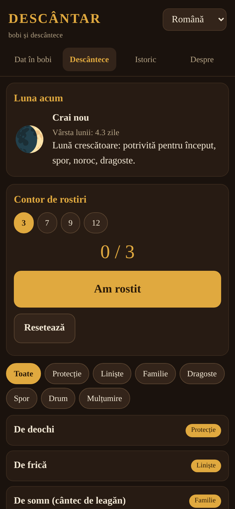

# DESCÂNTAR

[English](README.md) · [Română](README.ro.md) · [Français](README.fr.md) · [Italiano](README.it.md) · [Español](README.es.md) · **Português** · [Deutsch](README.de.md) · [Magyar](README.hu.md)

Adivinhação romena com feijões (41 feijões) e benzeduras tradicionais, interface em 8 línguas, num único ficheiro offline.

**[Abrir a aplicação →](https://descantar.chiuta.ro/)**

_Versão: 1.3.0 · Última atualização: 2026-11-14_

| 1 | 2 | 3 |
|---|---|---|
|  |  |  |

## Funcionalidades

- Três métodos: «tradicional» 3×3 (predefinido), a variante da Oltênia com os seus sinais e um método simples de três montes.
- Leitura Cabeça / Coração / Pés, sinais ímpar–par, balanço SIM/NÃO e resultado copiável; histórico das leituras.
- 12 benzeduras tradicionais, fase da lua, contador de recitações, gerador e guia copiável.

## Utilização

Abre a página online, ou descarrega `index.html` e abre-o num navegador recente. Sem instalação nem build.

## Limites

- Entretenimento e folclore, não é aconselhamento; não o uses para decisões médicas, jurídicas ou financeiras.
- As regras da Oltênia vêm de um texto que não consegui verificar; um verso da benzedura é pouco claro e está marcado como variante local.
- Interface e conteúdo folclórico (leituras, benzeduras, guia) em 8 línguas; as traduções dos textos tradicionais foram geradas com IA e não revistas por falantes nativos.

## Privacidade

Sem rastreamento, sem pedidos de rede (CSP `connect-src none`), sem contas. Os dados ficam neste navegador (localStorage) e podem ser apagados a qualquer momento.

## Licença

MIT — ver [LICENSE](LICENSE).
